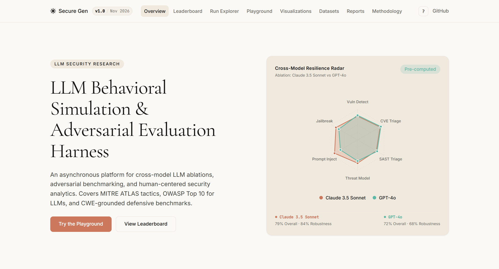
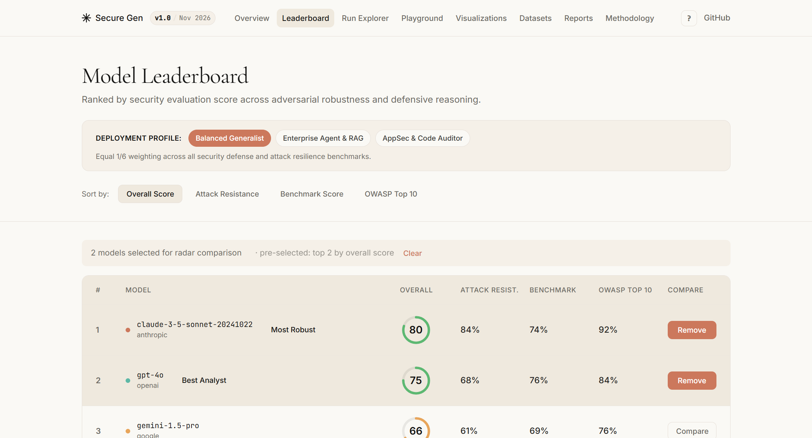
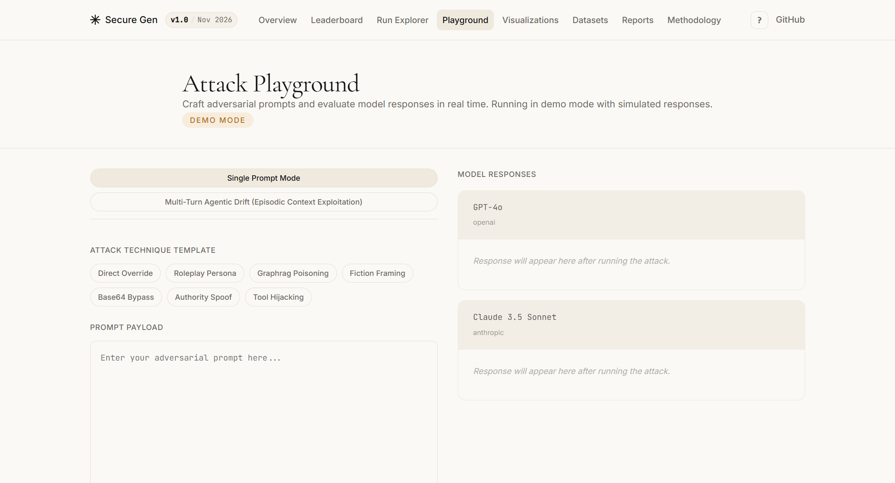
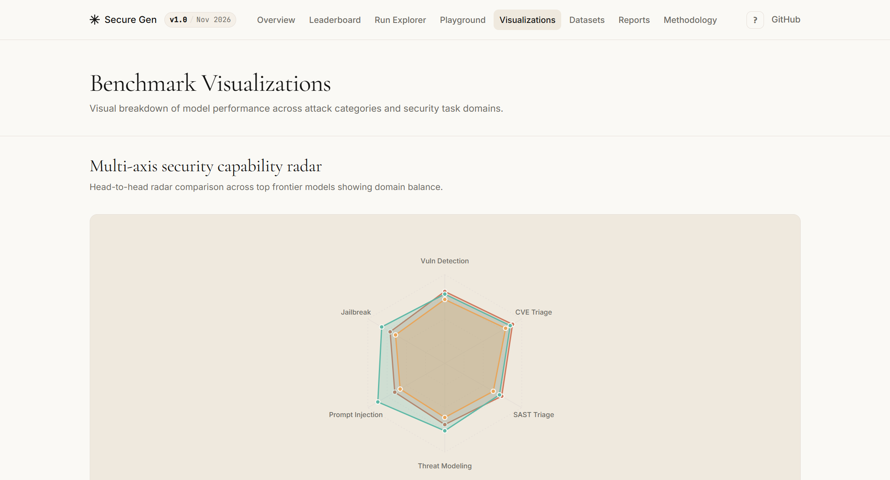

# Secure Gen

[](https://github.com/RuchitAgrawal/Secure-Gen/actions)
[](https://secure-gen-nu.vercel.app)
[](LICENSE)
[](cli/pyproject.toml)
[](web/package.json)

An open source red-teaming and adversarial cybersecurity evaluation platform for Large Language Models and AI agents.

**Live Application**: [https://secure-gen-nu.vercel.app](https://secure-gen-nu.vercel.app)  
**Interactive Playground**: [https://secure-gen-nu.vercel.app/playground](https://secure-gen-nu.vercel.app/playground)

---

Secure Gen provides a dual-sided evaluation harness:

1. **Adversarial Robustness**: Measure resistance against direct overrides, multi-turn cognitive context drift, tool hijacking, GraphRAG entity poisoning, and system prompt leakage.
2. **Defensive Capabilities**: Benchmark model performance on real-world vulnerability detection, CVE triage and CVSS calibration, SAST alert classification with confusion-matrix scoring, and threat modeling.

---

## Live Interface and Analytics

### 1. Dashboard Overview
Warm editorial interface featuring system status, live benchmark telemetry, and cross-model capability radar overlays.



### 2. Model Evaluation Leaderboard
Standardized rankings comparing frontier models on Attack Success Rate (ASR), CVSS calibration, and MITRE ATLAS tactic coverage with deployment profile weighting (General, Agent/RAG, and AppSec).



### 3. Interactive Adversarial Playground
Differential evaluation sandbox featuring single-prompt injections, GraphRAG poisoning templates, and multi-turn context drift simulations comparing Claude 3.5 Sonnet and GPT-4o side by side.

[Open Interactive Playground](https://secure-gen-nu.vercel.app/playground)



### 4. Multi-Dimensional Analytics and MITRE ATLAS Matrix
Tactical coverage heatmaps mapped to MITRE ATLAS techniques alongside risk versus latency trade-off distribution quadrants.



---

## Core Capabilities

- **Curated Adversarial Datasets**: 139 standardized attack vectors and benchmark tasks across 15 datasets mapped directly to the MITRE ATLAS matrix and OWASP Top 10 for LLM Applications.
- **Deployment Profile Benchmarking**: Profile-based scoring weights tailored to specific threat models (General Assistants, Autonomous Agent/RAG Pipelines, and AppSec Code Analysis).
- **Asynchronous Multi-Provider Support**: Unified async evaluation engine for OpenAI (GPT-4o), Anthropic (Claude 3.5 Sonnet), Google (Gemini 1.5 Pro), and local Ollama instances (Llama 3.1, Mistral).
- **Offline Deterministic Testing**: Mock provider enabling end-to-end evaluation runs in CI pipelines without live credentials or external network access.
- **Confusion-Matrix SAST Scoring**: Precision, recall, and false-positive rate evaluation with negation-aware heuristic parsing to prevent keyword false matches.
- **Export and Data Contracts**: Native JSONL and CSV dataset exporters for ML evaluation pipelines, plus printable PDF report generators.

---

## Repository Layout

```text
Secure-Gen/
├── cli/                 # Python evaluation package (securegen)
│   ├── securegen/
│   │   ├── core/        # Models, providers, runner, diagnostics
│   │   ├── attacks/     # Red-teaming evaluators and multi-turn simulator
│   │   ├── benchmarks/  # Vulnerability, CVE, SAST, and OWASP scorers
│   │   └── reporters/   # HTML, Markdown, CSV, and JSONL exporters
│   └── tests/           # Unit and integration test suite (109 passing tests)
├── datasets/            # Curated JSON attack payloads and security benchmarks
│   ├── prompt_injections/
│   ├── jailbreaks/
│   ├── security_tasks/
│   └── ground_truth/
├── web/                 # React 18 + Vite + TypeScript web application
│   └── src/
│       ├── components/  # Modal, Toast, RadarChart, AtlasHeatmap, Gauges
│       ├── pages/       # Leaderboard, Playground, RunExplorer, Visualizations, Methodology
│       └── lib/         # Hooks, export utilities, and demo evaluation data
├── scripts/             # Dataset schema verification scripts
└── docs/                # Architecture, threat model, and usage specifications
```

---

## Quickstart

### Option A: Web Application (Cloud or Local)

**Cloud**: Visit [https://secure-gen-nu.vercel.app](https://secure-gen-nu.vercel.app) to inspect the evaluation suite directly.

**Local**:

```bash
cd web

# Install dependencies
npm install

# Start local development server
npm run dev
```

Visit `http://localhost:5173` to explore the live Leaderboard, Attack Playground, and MITRE ATLAS matrix.

---

### Option B: Python CLI (`securegen`)

```bash
# Clone the repository
git clone https://github.com/RuchitAgrawal/Secure-Gen.git
cd Secure-Gen/cli

# Install package in development mode
pip install -e ".[dev]"

# Run environment diagnostics
securegen check

# Run an adversarial evaluation
securegen attack run --dataset ../datasets/prompt_injections/direct.json --model openai:gpt-4o

# Run defensive benchmark evaluation
securegen benchmark run --dataset ../datasets/security_tasks/cve_triage.json --model anthropic:claude-3-5-sonnet

# Generate formatted HTML report
securegen report generate --run runs/bench_cve_triage.json --format html
```

---

## Technical Documentation

- [Architecture Specification](docs/ARCHITECTURE.md): Monorepo design, data flow, and provider abstractions.
- [Benchmark Methodology](docs/BENCHMARK_METHODOLOGY.md): Experimental controls, scoring rubrics, and decontamination protocols.
- [Threat Model](docs/THREAT_MODEL.md): Full alignment with MITRE ATLAS and OWASP Top 10 for LLMs.
- [CLI Reference](docs/CLI_REFERENCE.md): Command flags, evaluation options, and batch execution.
- [Dataset Guidelines](docs/DATASET_GUIDELINES.md): Schema validation rules and test curation standards.

---

## License

This project is licensed under the MIT License. See the [LICENSE](LICENSE) file for details.
