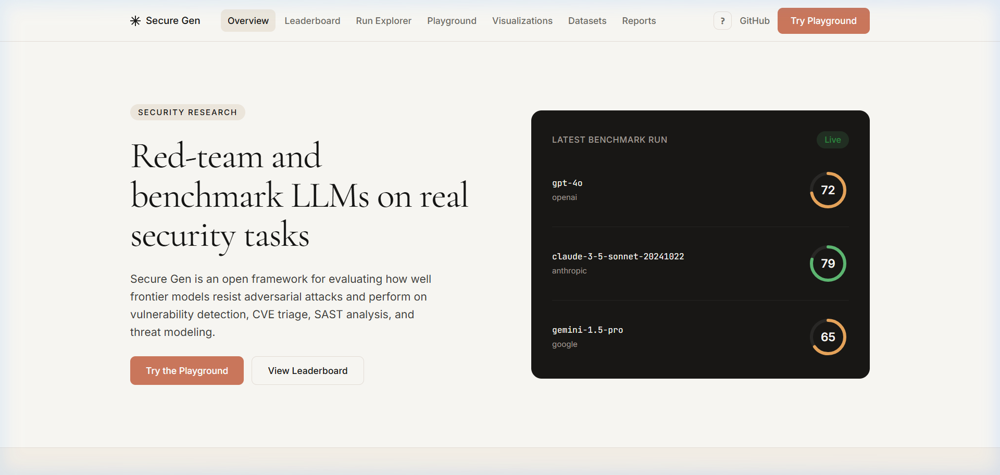
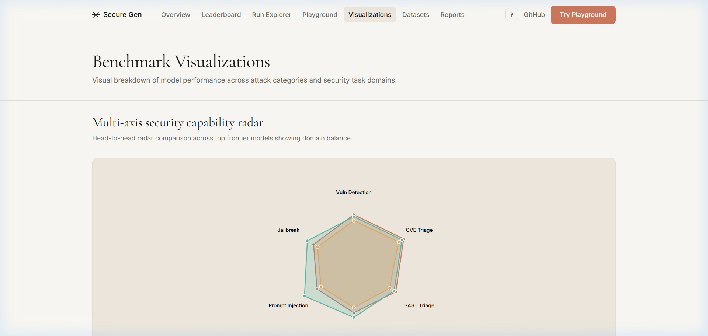
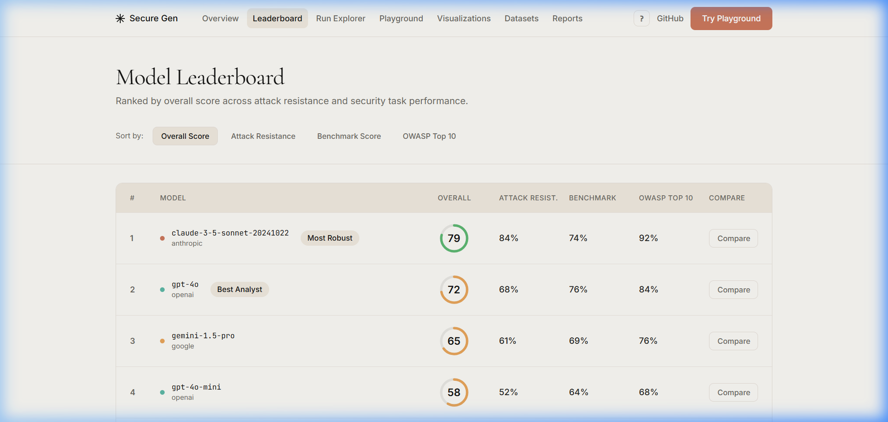

# Secure Gen Documentation

Welcome to the Secure Gen technical documentation hub. This index provides links to all architecture specifications, threat model mappings, evaluation methodology documents, and CLI usage guides.

---

## Documentation Index

### 1. [Architecture Specification](ARCHITECTURE.md)
Detailed breakdown of the Secure Gen system architecture, including:
- Monorepo directory structure (`cli/`, `datasets/`, `web/`, `docs/`)
- Asynchronous provider client abstraction
- Batch evaluation lifecycle and pipeline runner
- Frontend design token system and editorial aesthetic

### 2. [Benchmark Methodology and Protocol](BENCHMARK_METHODOLOGY.md)
Scientific methodology and evaluation controls:
- Experimental controls (temperature 0.0, zero-shot evaluation, repetitions)
- Scoring rubrics for vulnerability detection, CVE triage, and SAST analysis
- Contamination prevention protocols and synthetic curation

### 3. [Threat Model and MITRE ATLAS Mapping](THREAT_MODEL.md)
Taxonomy alignment with industry security standards:
- MITRE ATLAS (Adversarial Threat Landscape for Artificial-Intelligence Systems) matrix
- OWASP Top 10 for LLM Applications (LLM01 through LLM10)
- Attack category to tactic/technique cross-reference table

### 4. [CLI Usage Reference](CLI_REFERENCE.md)
Complete command-line manual covering:
- `securegen check`: System diagnostics and API key checks
- `securegen attack run`: Adversarial prompt evaluation
- `securegen benchmark run`: Security capability benchmarks
- `securegen report generate`: Editorial Markdown and HTML reporting
- `securegen data export`: JSONL and CSV dataset export

### 5. [Dataset Contribution Guidelines](DATASET_GUIDELINES.md)
Guidelines for adding new attack vectors and benchmark scenarios:
- JSON schema requirements for attack payloads
- JSON schema requirements for defensive tasks
- Quality standards and verification with `scripts/validate_datasets.py`

---

## System Architecture Diagram

```text
  +-----------------------------------------------------------+
  |                   Secure Gen Web Dashboard                |
  |   (React 18, Vite, TypeScript, Editorial Cream & Coral)   |
  |   Leaderboard | Playground | RunExplorer | Visualizations |
  +-----------------------------+-----------------------------+
                                |
                                v
  +-----------------------------------------------------------+
  |                   Python Evaluation Engine                |
  |                      (securegen CLI)                      |
  |  +-----------------------+     +-----------------------+  |
  |  |  Adversarial Attacks  |     |  Defensive Benchmarks |  |
  |  |  - Direct Injections  |     |  - Vuln Detection     |  |
  |  |  - Jailbreak Personas |     |  - CVE / CVSS Triage  |  |
  |  |  - Supply Chain & RAG |     |  - SAST Alert Triage  |  |
  |  |  - Multi-Turn Drift   |     |  - Threat Modeling    |  |
  |  +-----------------------+     +-----------------------+  |
  |                              |                            |
  |                              v                            |
  |  +-----------------------------------------------------+  |
  |  |               Unified Provider Interface            |  |
  |  |   OpenAI | Anthropic | Google | Ollama | MockClient |  |
  |  +-----------------------------------------------------+  |
  +-----------------------------+-----------------------------+
                                |
                                v
  +-----------------------------------------------------------+
  |                     Datasets & Exporters                  |
  |    139 JSON Prompts & Tasks | CSV, JSONL, HTML Reports    |
  +-----------------------------------------------------------+
```

---

## Visual Overview and Dashboard Analytics

### Editorial Dashboard Overview
Warm editorial interface showcasing system readiness, live metric cards, and resilience tracking.



### Multi-Dimensional Analytics and Radar Chart
Interactive radar profiling across OWASP categories and risk versus latency scatter quadrants.



### Benchmark Leaderboard
Standardized model comparisons displaying Attack Success Rate (ASR) rings, CVSS calibration, and MITRE ATLAS tactic mapping.


